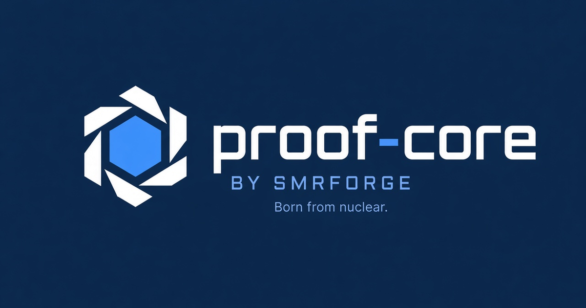
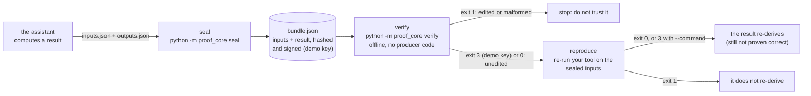
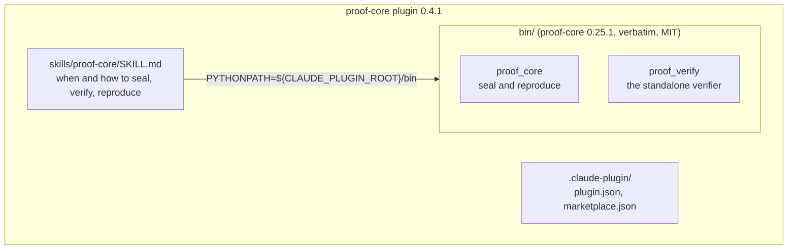
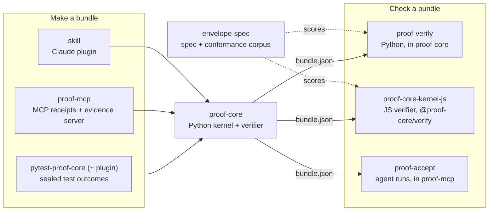

<p align="center">
  
</p>

# proof-core plugin

**Give a Claude Code agent three verbs: seal a result, verify a record, re-run it.** Not "trust us". Check us.

Repo: `gitlab.com/proof-core/skill` · MIT · a Claude Code plugin with one Agent Skill · Python 3.11+ standard
library · plugin v0.4.1 · vendors [proof-core](https://gitlab.com/proof-core/proof-core) 0.25.1 · no install,
no network, no account

## What this is

A Claude Code plugin that ships an Agent Skill wrapping the open proof-core kernel. When the agent produces a
result someone downstream has to trust (a number, a decision, a test or evaluation outcome), it can seal the
result with its inputs into a tamper-evident bundle, verify a bundle offline, or re-run one to confirm the
result re-derives. The kernel is **vendored into this plugin** (`bin/`), so it runs with nothing installed,
and everything happens on the machine running the agent.

## Run it in 60 seconds

Install the plugin:

```
claude plugin marketplace add https://gitlab.com/proof-core/skill
claude plugin install proof-core@proof-core-marketplace
```

Then ask the agent to seal a result it computed, or check a bundle someone sent you. To see the same verbs
without an agent, run the vendored copy from a clone:

```bash
git clone https://gitlab.com/proof-core/skill && cd skill
echo '{"a": 2, "b": 3}' > inputs.json
echo '{"total": 5}' > outputs.json
PYTHONPATH=bin python -m proof_core seal --capability arith:add --engine my-tool --engine-version 1.0 \
    --inputs inputs.json --outputs outputs.json -o bundle.json
PYTHONPATH=bin python -m proof_core verify bundle.json
```

What `verify` prints, trimmed (exit 3, the normal result under the public demo key):

```text
OK  integrity verified -- origin NOT established (demo pin): bundle.json
    every hash recomputes and the Ed25519 signature is valid under the pinned key, so
    the record is UNEDITED since it was signed.
```

Change the sealed `total` from 5 to 6 in `bundle.json` and verify again:

```text
FAIL  bundle.json
  - result: manifest sha256:... != recomputed sha256:...
```

## How it works

When an assistant uses the skill, everything runs on the local machine from the copy of proof-core inside the
plugin:



What the plugin bundles:



All three verbs run from the vendored copy with `PYTHONPATH="${CLAUDE_PLUGIN_ROOT}/bin" python -m proof_core
<seal|verify|reproduce>`:

- **seal** a result (its inputs and outputs) into a signed, canonical JSON bundle.
- **verify** a bundle offline: the hashes recompute and the signature checks. This is a standalone second
  implementation (`proof_verify`) that imports no producer code.
- **reproduce** a bundle by re-running the work on its sealed inputs and confirming the result re-derives.

## Limits, stated plainly

- **A seal proves the record is unaltered and that it re-derives from its sealed inputs.** It does not prove
  the result is correct, nor that the agent actually ran what it claims. Catching that needs independent
  reproduction by a party the producer does not control.
- **The public build pins a demo key**, so verify reports "integrity-only" (exit 3). That is the normal result
  and is not a production origin pass.
- **Verify exit codes:** 0 integrity and origin (only with a real pinned key), 1 fail, 2 unreadable or usage
  error, 3 integrity-only, 4 unsupported canon, 5 chain incomplete or unknown (only with `--upstream`), 6
  unsupported signature suite. An automated origin gate passes only exit 0. [SKILL.md](skills/proof-core/SKILL.md)
  has the details.

## Re-vendoring

The `bin/` tree is a verbatim copy of proof-core's `proof_core/` and `proof_verify/` packages and is never
edited here. CI checks it still matches upstream. See [VENDORED.md](VENDORED.md).

## The proof-core family

Every repo lives at [gitlab.com/proof-core](https://gitlab.com/proof-core). The code repos are MIT; envelope-spec,
the format standard, is Apache-2.0. They all make or check the same bundle format, so a bundle made by any of
them is checked by the same verifiers.

The bundles this plugin makes follow [envelope-spec](https://gitlab.com/proof-core/envelope-spec).



| Repo | Use it to |
|---|---|
| [proof-core](https://gitlab.com/proof-core/proof-core) | v0.25.1, the Python kernel and verifier: seal, verify and reproduce any computed result (standard library only), envelope v3 and v4 |
| [proof-core-kernel-js](https://gitlab.com/proof-core/proof-core-kernel-js) | v0.8.1 (`@proof-core/verify`), the JavaScript verifier: verify bundles in Node or a browser, with no dependencies |
| [envelope-spec](https://gitlab.com/proof-core/envelope-spec) | v1.0.0, the spec and its corpus: the bundle format's written standard, JSON Schema, and 636 conformance vectors to test any verifier against |
| [proof-mcp](https://gitlab.com/proof-core/proof-mcp) | v0.7.1, MCP receipts and an evidence server: receipt format v2 with a coverage section, code-mode receipts and loop receipts for ordinary tool-calling loops, MCP over stdio and streamable HTTP, async hosts, `proof-accept` to accept or reject a sealed run, and `proof-mcp serve`, an evidence MCP server |
| [skill](https://gitlab.com/proof-core/skill) | v0.4.1, the Claude Code plugin: give an agent seal, verify and reproduce as a skill, with proof-core 0.25.1 bundled so it runs offline |
| [pytest-proof-core](https://gitlab.com/proof-core/pytest-proof-core) | v0.1.0, sealed test outcomes: seal each test's outcome and re-check it later in CI |
| [pytest-proof-core-plugin](https://gitlab.com/proof-core/pytest-proof-core-plugin) | v0.3.0, sealed test outcomes for Claude Code: pytest-proof-core packaged as a plugin (it bundles proof-core 0.24.0) |

## License

MIT © SMRFORGE LLC.
