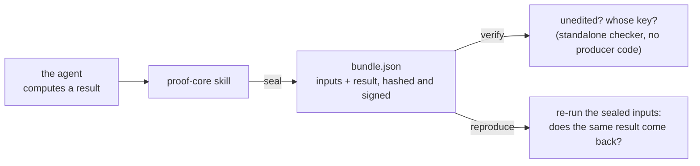
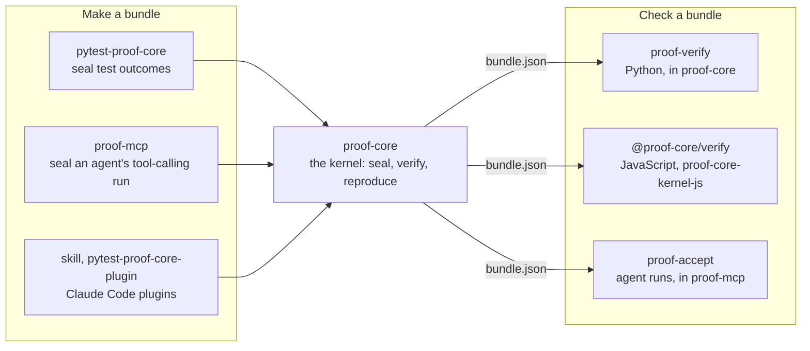

<p align="center">
  
</p>

# proof-core plugin

**Give a Claude Code agent three verbs: seal a result, verify a record, re-run it.** Not "trust us". Check us.

Repo: `gitlab.com/proof-core/skill` · MIT · a Claude Code plugin with one Agent Skill · Python 3.11+ standard
library · vendors [proof-core](https://gitlab.com/proof-core/proof-core) 0.20.0 · no install, no network, no
account

## What this is

A Claude Code plugin that ships an Agent Skill wrapping the open proof-core kernel. When the agent produces a
result someone downstream has to trust (a number, a decision, a test or evaluation outcome), it can seal the
result with its inputs into a tamper-evident bundle, verify a bundle offline, or re-run one to confirm the
result re-derives. The kernel is **vendored into this plugin** (`bin/`), so it runs with nothing installed,
and everything happens on the machine running the agent.

## Run it in 60 seconds

Install the plugin:

```
claude plugin marketplace add https://gitlab.com/proof-core/skill
claude plugin install proof-core@proof-core-marketplace
```

Then ask the agent to seal a result it computed, or check a bundle someone sent you. To see the same verbs
without an agent, run the vendored copy from a clone:

```bash
git clone https://gitlab.com/proof-core/skill && cd skill
echo '{"a": 2, "b": 3}' > inputs.json
echo '{"total": 5}' > outputs.json
PYTHONPATH=bin python -m proof_core seal --capability arith:add --engine my-tool --engine-version 1.0 \
    --inputs inputs.json --outputs outputs.json -o bundle.json
PYTHONPATH=bin python -m proof_core verify bundle.json
```

What `verify` prints, trimmed (exit 3, the normal result under the public demo key):

```text
OK  integrity verified -- origin NOT established (demo pin): bundle.json
    every hash recomputes and the Ed25519 signature is valid under the pinned key, so
    the record is UNEDITED since it was signed.
```

Change the sealed `total` from 5 to 6 in `bundle.json` and verify again:

```text
FAIL  bundle.json
  - result: manifest sha256:... != recomputed sha256:...
```

## How it works



All three verbs run from the vendored copy with `PYTHONPATH="${CLAUDE_PLUGIN_ROOT}/bin" python -m proof_core
<seal|verify|reproduce>`:

- **seal** a result (its inputs and outputs) into a signed, canonical JSON bundle.
- **verify** a bundle offline: the hashes recompute and the signature checks. This is a standalone second
  implementation (`proof_verify`) that imports no producer code.
- **reproduce** a bundle by re-running the work on its sealed inputs and confirming the result re-derives.

## Limits, stated plainly

- **A seal proves the record is unaltered and that it re-derives from its sealed inputs.** It does not prove
  the result is correct, nor that the agent actually ran what it claims. Catching that needs independent
  reproduction by a party the producer does not control.
- **The public build pins a demo key**, so verify reports "integrity-only" (exit 3). That is the normal result
  and is not a production origin pass.

## Re-vendoring

The `bin/` tree is a verbatim copy of proof-core's `proof_core/` and `proof_verify/` packages and is never
edited here. CI checks it still matches upstream. See [VENDORED.md](VENDORED.md).

## The proof-core family

Every repo lives at [gitlab.com/proof-core](https://gitlab.com/proof-core). The code repos are MIT; envelope-spec,
the format standard, is Apache-2.0. They all make or check the same bundle format, so a bundle made by any of
them is checked by the same verifiers.

The bundles this plugin makes follow [envelope-spec](https://gitlab.com/proof-core/envelope-spec).



| Repo | Use it to |
|---|---|
| [proof-core](https://gitlab.com/proof-core/proof-core) | seal, verify and reproduce any computed result (Python, standard library only) |
| [pytest-proof-core](https://gitlab.com/proof-core/pytest-proof-core) | seal each test's outcome and re-check it later in CI |
| [envelope-spec](https://gitlab.com/proof-core/envelope-spec) | the bundle format's written standard: spec, JSON Schema, and 79 conformance vectors to test any verifier against |
| [proof-mcp](https://gitlab.com/proof-core/proof-mcp) | v0.2.0: code-mode receipts, MCP over stdio and streamable HTTP, async hosts, loop consistency receipts for ordinary tool-calling loops, and `proof-accept` to accept or reject a sealed run |
| [proof-core-kernel-js](https://gitlab.com/proof-core/proof-core-kernel-js) | verify bundles in Node or a browser, with no dependencies |
| [skill](https://gitlab.com/proof-core/skill) **(this repo)** | give a Claude Code agent seal, verify and reproduce as a skill |
| [pytest-proof-core-plugin](https://gitlab.com/proof-core/pytest-proof-core-plugin) | the pytest plugin, packaged for Claude Code |

## License

MIT © SMRFORGE LLC.
